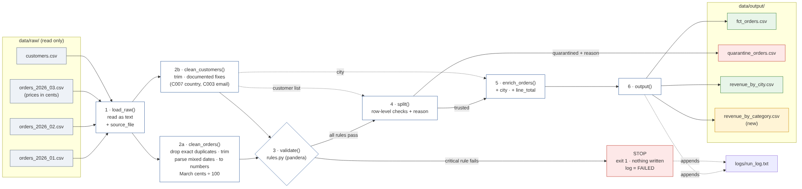

# pipeline_shop — a reproducible, validated data pipeline

Group project for **Chapter 3: Reproducible & Validated Data Pipelines** (Lab 3.3, home exercise).
Built on the `shop_pipeline` starter: it turns raw online-shop order files into trusted, documented outputs with **one command**.

## Group members

- Siddharth K
- Vivek Talreja
- Parth Benke
- Kshitij Shelar
- Shivai Gore
- Tarun Prakash

## What we added (Lab 3.3)

| Change | Where |
|---|---|
| New output `revenue_by_category.csv` | `pipeline.py` → `output()` |
| 3 new validation rules (+ 2 from Lab 3.2), incl. a **custom check** | `rules.py` |
| March cents → EUR correction moved **before** validation | `pipeline.py` → `clean_orders()` |
| Documented customer master-data fixes (C007, C003) | `pipeline.py` → `CUSTOMER_FIXES` |
| Lineage drawing | `docs/lineage.png` (source: `docs/lineage.mmd`) |
| Cleaning log | this README, section *Cleaning log* |
| Run log committed | `logs/run_log.txt` |

## Setup and run

```bash
cd pipeline_shop
python -m venv .venv
source .venv/bin/activate        # Windows: .venv\Scripts\activate
pip install -r requirements.txt
python pipeline.py
```

Every run appends a block to `logs/run_log.txt`. Run it again — you get the same result.

Expected result: 17 rows loaded → 1 duplicate removed → **12 trusted, 4 quarantined, revenue EUR 4,015**.

## Lineage



Raw files → load → clean → validate → (STOP **or** split) → enrich → output. The quarantine branch leaves at `split()`;
a failed critical rule leaves at `validate()` and writes nothing except the run log.

## Project structure

```
pipeline_shop/
├── README.md            this file: how to run, data dictionary, cleaning rules
├── requirements.txt     pandas, pandera
├── pipeline.py          the steps: load → clean → validate → split → enrich → output
├── rules.py             validation rules (pandera), one line each + custom check
├── docs/
│   ├── lineage.png      pipeline flow drawing (reused in Chapter 4)
│   └── lineage.mmd      Mermaid source of the drawing
├── data/
│   ├── raw/             files exactly as received — read, never written
│   └── output/          trusted outputs (created by the pipeline, committed for review)
├── logs/
│   └── run_log.txt      what happened on every run (created by the pipeline)
└── extras/
    └── orders_2026_04.csv   a new month of data — used in Lab 3.2
```

Data flows one way: **raw → clean → output**. Never backwards, never overwriting raw.

## Inputs (`data/raw/`)

| File | Contents |
|---|---|
| `orders_2026_01.csv`, `orders_2026_02.csv`, `orders_2026_03.csv` | Monthly order exports: order_id, order_date, customer_id, category, quantity, unit_price |
| `customers.csv` | Customer master: customer_id, customer_name, city, country, email, segment |

## Steps (`pipeline.py`)

| Step | Function | What it does |
|---|---|---|
| Load | `load_raw()` | Reads every `orders_*.csv` as text and adds `source_file` (start of lineage) |
| Clean | `clean_orders()`, `clean_customers()` | Removes exact duplicates, trims text, parses mixed date formats, converts numbers, converts March cents → EUR, applies documented customer fixes |
| Validate | `validate()` | Runs the rules in `rules.py`. **Critical rule broken → stop, write nothing** |
| Split | `split()` | Row-level problems → **quarantine with a reason** |
| Enrich | `enrich_orders()` | Adds the customer's city and `line_total` |
| Output | `output()` | Writes the four output files and the revenue to the run log |

**Stop or quarantine?** Stop for problems that break the whole table (e.g. a duplicate ID); quarantine problems that affect single rows (e.g. an unknown customer).

## Outputs (`data/output/`) — data dictionary

**`fct_orders.csv`** — trusted orders, ready for analysis

| Column | Meaning | Unit / rule |
|---|---|---|
| order_id | Order identifier | one capital letter + 3 digits, unique |
| order_date | Date of the order | YYYY-MM-DD |
| customer_id | Customer identifier | must exist in customers.csv |
| category | Product category | Accessories or Electronics |
| quantity | Items ordered | > 0 |
| unit_price | Price per item | EUR, ≥ 0 |
| source_file | Raw file the row came from | lineage |
| city | Customer's city | from customers.csv |
| line_total | Revenue of the order line | quantity × unit_price, EUR |

**`quarantine_orders.csv`** — rows held back: same columns as the cleaned orders plus `reason`.

**`revenue_by_city.csv`** — business summary: `city`, `line_total` (sum, EUR).

**`revenue_by_category.csv`** — *new* business summary, one row per product category, sorted by revenue

| Column | Meaning | Unit / rule |
|---|---|---|
| category | Product category | Accessories or Electronics |
| orders | Number of distinct trusted orders in the category | count |
| items | Total items sold (sum of `quantity`) | count, integer |
| revenue | Sum of `line_total` | EUR, 2 decimals |
| share_pct | Category revenue as % of total trusted revenue | %, 1 decimal, column sums to 100 |

Current result: Electronics EUR 3,782.59 (94.2 %), Accessories EUR 232.41 (5.8 %) — total EUR 4,015.00.

**Customer master (`customers.csv`) — columns now validated**

| Column | Rule |
|---|---|
| customer_id | unique, not empty, pattern `^C\d{3}$` |
| customer_name, city | not empty |
| email | `name@domain.tld` or empty |
| country | Germany, Austria or Switzerland |
| segment | Private or Business |

## Cleaning rules

| Rule | Where | Action |
|---|---|---|
| Exact duplicate rows | `clean_orders()` | removed |
| Dates as YYYY-MM-DD or DD.MM.YYYY | `parse_mixed_date()` | unified |
| order_id unique, not empty, pattern `^[A-Z]\d{3}$` | `rules.py` | stop |
| category in the allowed list | `rules.py` | stop |
| unit_price ≥ 0 | `rules.py` | stop |
| **new** unit_price ≤ 5,000 EUR (catches unconverted cents) | `rules.py` | stop |
| **new (custom check)** order_date not in the future | `rules.py` → `not_in_future()` | stop |
| **new** segment in {Private, Business} | `rules.py` | stop |
| email format `name@domain.tld` or empty (Lab 3.2) | `rules.py` | stop |
| country in {Germany, Austria, Switzerland} (Lab 3.2) | `rules.py` | stop |
| March export has prices in cents | `clean_orders()` | divided by 100 |
| Known customer master-data errors | `clean_customers()` → `CUSTOMER_FIXES` | corrected, logged |
| quantity ≤ 0, missing price, missing date, unknown customer | `split()` | quarantine |

### Why these new rules?

| Rule | Chapter 2 dimension | Why stop (not quarantine)? |
|---|---|---|
| `order_date` not in the future (custom `Check`) | Validity / Timeliness | A future date means the export or date parsing is broken (e.g. day/month swapped) — this affects the whole file, not one row. |
| `unit_price` ≤ 5,000 | Validity (range) / Accuracy | The shop's most expensive item is about EUR 1,200. A price above 5,000 almost certainly means a unit error (cents) for a whole export — exactly the March problem from Lab 3.1. |
| `segment` in {Private, Business} | Validity (allowed values) / Consistency | Segment drives reporting; an unknown value means the master data schema changed. |

Test of the custom check: adding a row dated `2099-01-01` makes the pipeline stop with `order_date lies in the future`.

## Cleaning log

What changed in the data on the way from raw to output, and why. Raw files are **never** edited — every fix lives in code and is applied again on every run.

| # | What changed | Rows affected | Why | Where |
|---|---|---|---|---|
| 1 | Exact duplicate row removed | 1 (O108, Feb) | Same order exported twice | `clean_orders()` |
| 2 | Leading/trailing spaces trimmed | all text columns | Whitespace breaks joins and `isin` checks | `clean_orders()`, `clean_customers()` |
| 3 | `DD.MM.YYYY` dates converted to `YYYY-MM-DD` | 2 (O103, O112) | Mixed date formats in the exports | `parse_mixed_date()` |
| 4 | March `unit_price` divided by 100 | 3 (O114–O116) | March export stores cents (1999 = EUR 19.99). Without this, revenue is EUR 12,565 instead of 4,015. Moved **before** validation so the new max-price rule sees EUR values. | `clean_orders()` |
| 5 | C007 `country`: `Germny` → `Austria` | 1 customer | Typo. City is Vienna and the email ends in `.at`, so Austria (not Germany) is correct. | `CUSTOMER_FIXES` |
| 6 | C003 `email`: `clara.schmidt(at)web.de` → `clara.schmidt@web.de` | 1 customer | `(at)` written instead of `@`; the intended address is unambiguous. | `CUSTOMER_FIXES` |
| 7 | C008 empty email kept | 1 customer | Allowed by the rule (contact data incomplete, but orders are valid). Should be completed in the source CRM. | — |
| 8 | Rows quarantined with a reason | 4 (O105 quantity −1, O109 unknown customer C099, O111 missing price, O116 missing date) | Single-row problems: hold back, don't stop the run | `split()` |

**Lab 3.2 note:** with the April file (`extras/orders_2026_04.csv`) in `data/raw/`, the pipeline stops on purpose. The duplicate `O101`, the bad ID `A1001`, the category `Gadgets` and the price `-5.0` break critical rules. The first `FAILED` block in `logs/run_log.txt` documents this run; the April file was removed again afterwards.
